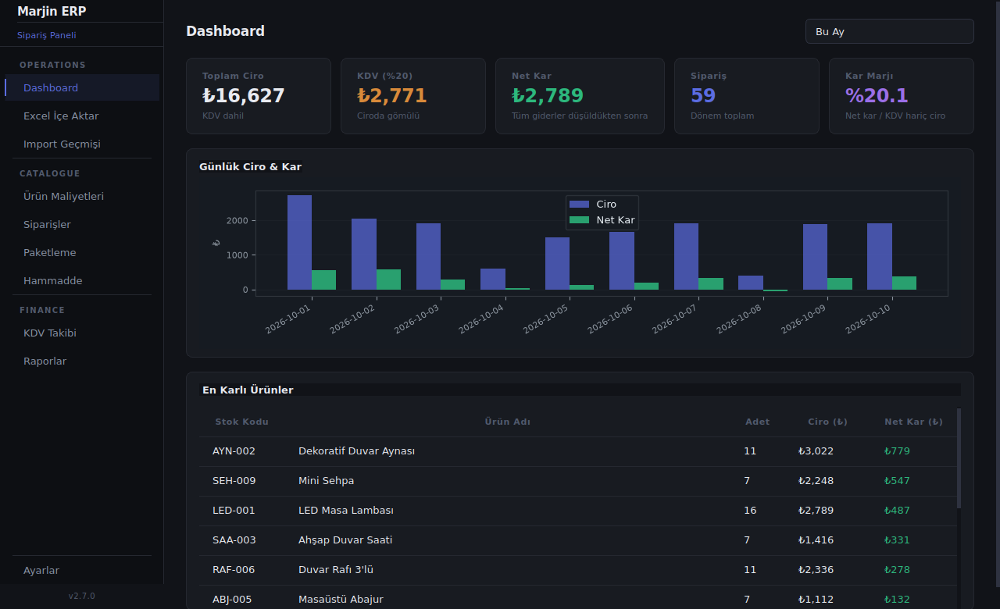

# Marjin ERP — Finans & Kar/Zarar Paneli

Trendyol satışlarınız için otomatik kar/zarar hesaplama ve dashboard uygulaması. PyQt6 ile geliştirilmiş, yerel SQLite veritabanı kullanan masaüstü bir ERP paneli.



## Özellikler

- **Otomatik kâr/zarar hesaplama** — komisyon, kargo, paketleme ve alış maliyetlerini tek seferde girip her siparişte otomatik hesaplatın
- **Excel içe aktarma** — Trendyol sipariş raporunu tek tıkla içeri alın, sistem satırları otomatik işler
- **Dashboard** — günlük ciro/kâr grafiği, dönem filtreleri (bugün / hafta / ay / tümü), en kârlı ürünler tablosu
- **Sipariş & ürün yönetimi** — stok kodu/ürün adına göre arama ve filtreleme
- **Paketleme & hammadde takibi** — koli maliyetleri ve kritik stok uyarıları
- **KDV takibi** — aylık hesaplanan/indirilecek/ödenecek KDV özeti
- **PDF/Excel rapor** — tek tıkla şirket raporunu dışa aktarın

## Teknoloji

Python 3.11+ · PyQt6 · SQLite3 · pandas · matplotlib · openpyxl

---

## Kurulum

### 1. Python 3.11+ yükleyin
https://www.python.org/downloads/

### 2. Gerekli kütüphaneleri kurun
```
pip install -r requirements.txt
```

### 3. Uygulamayı başlatın
```
python main.py
```

---

## Kullanım Kılavuzu

### Adım 1 — Ürün Maliyetlerini Girin
- Sol menüden **"Ürün Maliyetleri"** sekmesine gidin
- Her ürün için **Alış Maliyeti** (birim) ve **Paketleme Maliyeti** girin
- Bu değerler sisteme bir kez girilir, sonraki importlarda otomatik kullanılır

### Adım 2 — Excel Raporu İçe Aktarın
- **"Excel İçe Aktar"** sekmesine gidin
- Trendyol'dan indirdiğiniz `Siparişleriniz_*.xlsx` dosyasını seçin
- **"İçe Aktar ve Hesapla"** butonuna tıklayın
- Sistem otomatik olarak her sipariş için şu hesaplamayı yapar:

```
Net Kar = Faturalanacak Tutar
        - Komisyon Tutarı (Faturalanacak × Komisyon Oranı%)
        - Kargo Tutarı (Trendyol'dan gelen)
        - Paketleme Maliyeti (sizin girdiğiniz)
        - Alış Maliyeti × Adet
```

### Adım 3 — Dashboard'ı İnceleyin
- **"Dashboard"** sekmesinde özet metrikleri görün
- Dönem filtresi: Bugün / Bu Hafta / Bu Ay / Tümü
- Günlük Ciro & Kar grafiği
- En karlı ürünler tablosu

### Adım 4 — Siparişleri İnceleyin
- **"Siparişler"** sekmesinde tüm siparişleri filtreleyin
- Stok kodu veya ürün adına göre arama yapın
- Her sipariş için detaylı maliyet dökümünü görün

---

## Veri Depolama

Veriler bilgisayarınızdaki şu konuma kaydedilir:
```
C:\Users\[Kullanıcı Adı]\marjin_erp_data.db
```
Bu dosyayı yedeklemeniz verilerinizi korur.

---

## Önemli Notlar

- Alış maliyeti girilmemiş ürünler için kar hesabı **eksik** olur
- Aynı Excel'i iki kez aktarırsanız siparişler **tekrar eklenir** — dikkatli olun
- Trendyol'un rapor formatı değişirse `core/excel_parser.py` dosyasındaki `COLUMN_MAP` güncellenmelidir
- **İadeler şu an net kâr hesabına dahil değildir** — bu nedenle görüntülenen kâr, iade oranı yüksek dönemlerde olduğundan fazla görünebilir (bkz. Yol Haritası)

---

## Yol Haritası

- [ ] **İade takibi** — iade edilen siparişlerin kâr/zarar hesaplamasından otomatik düşülmesi (şu an iadeler hesaba dahil değil, bu nedenle net kâr olduğundan yüksek görünebilir)

---

## Sorun Giderme

**"ModuleNotFoundError: No module named 'PyQt6'"**
→ `pip install PyQt6` komutunu çalıştırın

**"Excel dosyası açılamıyor"**
→ Dosyanın "Tedarikci_Siparisleri" isimli sheet içerdiğini kontrol edin

**Grafik görünmüyor**
→ `pip install matplotlib` komutunu çalıştırın
